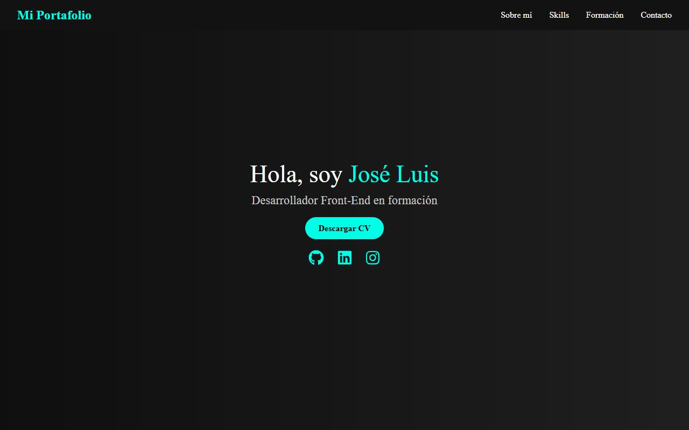
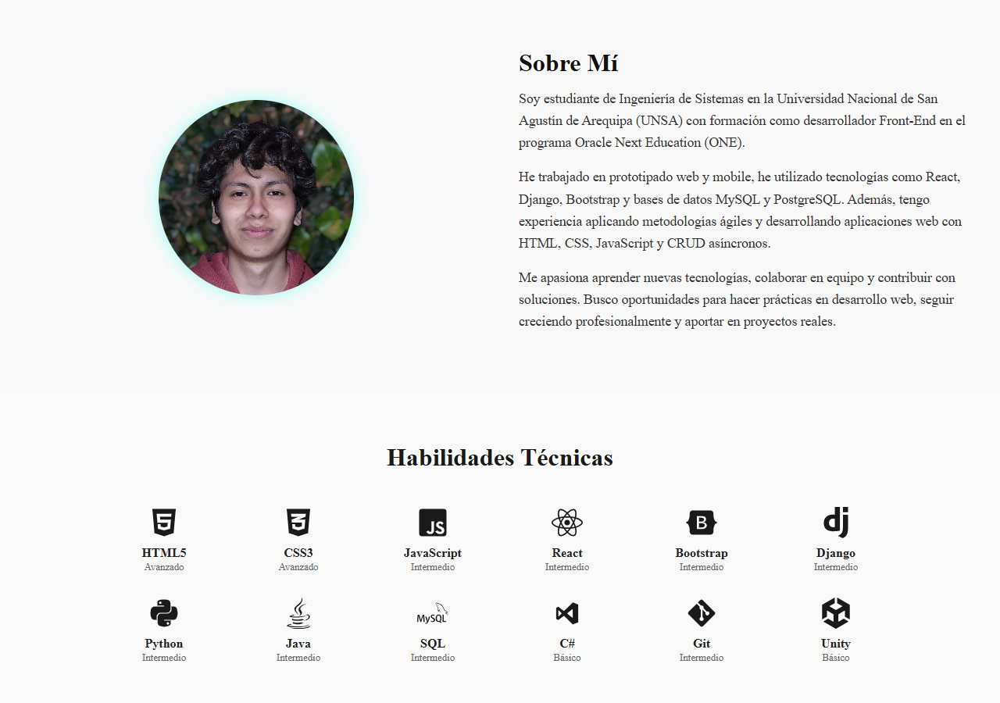
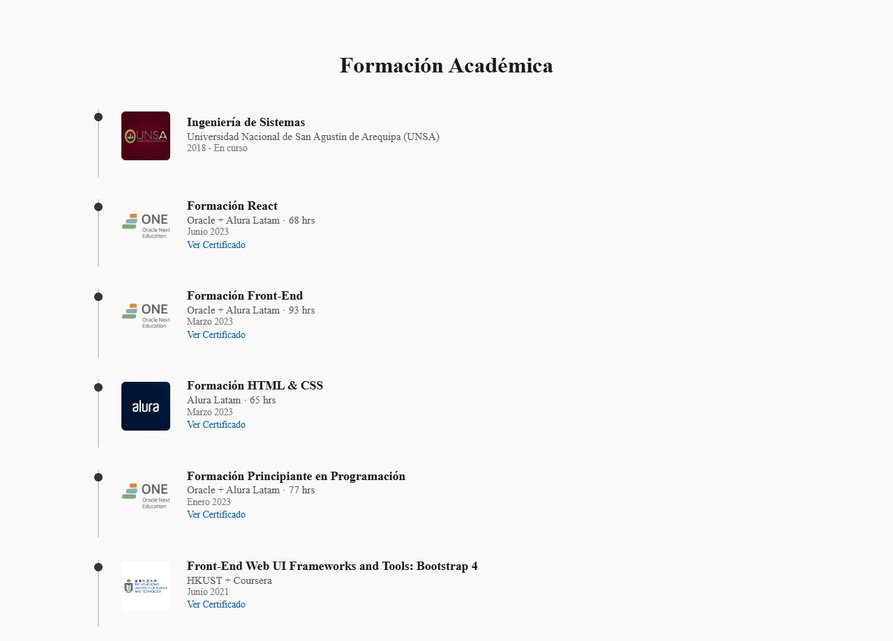
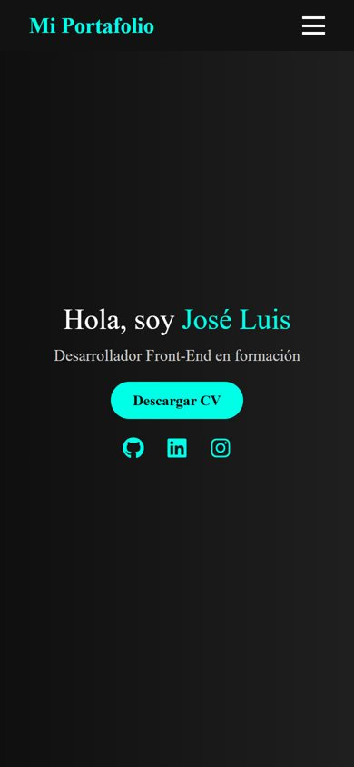

# Portafolio en React

Portafolio personal de una sola página que hice en junio de 2025 para practicar React. Tiene presentación, sobre mí, habilidades, formación con enlaces a los certificados y un formulario de contacto. Mi portafolio actual es otro: [portafolio-jlcg.vercel.app](https://portafolio-jlcg.vercel.app/).



## Qué tiene

- Cada sección es un componente (`src/sections/`) con su propia hoja de estilos en `src/styles/`.
- Menú fijo que en el celular se vuelve un botón desplegable.
- Formulario de contacto que valida los campos y envía el mensaje con Formspree.
- Habilidades con íconos de `react-icons` y nivel de cada una.
- Línea de tiempo de formación con el logo de cada institución.



<p>


</p>

## Tecnologías

React 19 con Vite y CSS propio, sin librerías de componentes.

## Ejecutarlo

```
npm install
npm run dev
```

Se abre en `http://localhost:5173/mi-portafolio-react/`.
